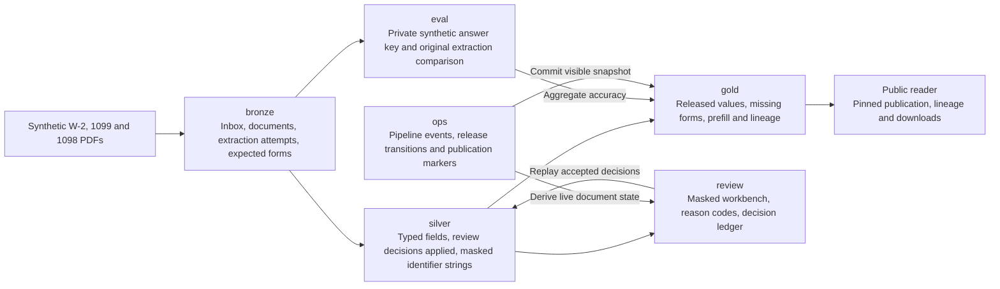

# LedgerLens

LedgerLens turns synthetic tax documents into reviewable, traceable outputs on Databricks. A reader can inspect which expected forms arrived, trace a released amount to the original extraction and any reviewer correction, and download a pre-filled result from the same publication. The workbench gives authenticated reviewers a separate place to resolve uncertain extractions.

## Demo and evidence

| Artifact | Link or status |
|---|---|
| Public Streamlit demo | `{{RELEASE:DEMO_APP_URL}}` |
| Demo integration evidence for the release | `{{RELEASE:DEMO_RUN_URL}}` |
| Publication and lineage walkthrough | `{{RELEASE:PUBLICATION_GIF}}` |
| Reviewer workbench walkthrough | `{{RELEASE:REVIEW_GIF}}` |

The [first demo integration run](https://github.com/radkay/ledgerlens/actions/runs/45540750902) verified bundle deployment, Processing, Evaluation, and the Gold smoke checks. The [release runbook](docs/RUNBOOK-release.md) covers rebuilding the catalogs, publishing the public app, and verifying a release.

## Architecture



Digital adapters handle W-2, 1099 and 1098 forms. Raster-only fixtures and the managed `ai_parse_document` adapter exercise scanned-document handling. The evaluator compares original extraction attempts against a private synthetic answer key. Gold exposes only aggregates from that comparison.

## Governance and identities

Development and demo use separate Unity Catalog catalogs and environment-specific service principals. CI and release evidence deploy the bundle as scoped principals and run Processing and Evaluation jobs under their own identities. The public app uses the demo reader and can query only the contracted Gold serving views. Review actions run under the authenticated workspace user through the environment's reviewer group. Original PDFs and the evaluation answer key stay outside that group’s grants.

Raw extraction records remain in Bronze. Unity Catalog masks both Silver identifier value columns. Members of the environment's identifier-readers group can see full values in Silver. Reviewers see only the last four digits, such as `****1234`, through the workbench. Other callers with Silver access receive `NULL` for identifier fields. The workbench keeps the last-four projection even for reviewers who also belong to the full-value group. Gold excludes identifier values. The [contract](CONTRACT.md) lists exact grants and boundaries.

## Publication and replay

Processing freezes its input watermark, replays accepted decisions in order, and writes Silver and Gold rows under one logical run ID. It checks grain, completeness, and lineage before appending the publication marker. Incomplete writes leave the previous release visible. Duplicate triggers reuse the current publication when the input digest matches. Recall removes a document from the next release and leaves published history intact.

Readers resolve the latest publication once per request and use its run ID for snapshot queries. The live document state and workbench are separate projections. Evaluation may attach accuracy later to the same run, so the app can show that metric as pending.

## Public Runtime agent

The approved public design lets visitors choose from preset questions. The live Runtime agent answers from published Gold, caches each preset answer for its publication, and limits live generation with a daily cap. Repeated selections reuse the answer for that publication. The MCP lane owns implementation and live verification. [Runtime agent evidence and rollout](docs/evidence/runtime-mcp.md)

## Rebuild from this repo

Use Python 3.12.3, uv 0.9.18, and Databricks CLI 1.28.0 for the Databricks path.

```bash
git clone https://github.com/radkay/ledgerlens.git
cd ledgerlens
UV_CACHE_DIR=.uv-cache uv sync --locked
UV_CACHE_DIR=.uv-cache uv run --no-sync python -m unittest discover -s tests
UV_CACHE_DIR=.uv-cache uv run --no-sync python provisioning/provision.py dev --plan
```

The offline plan prints catalog DDL. To rebuild in Databricks, create the documented workload identities, apply the provisioner as workspace admin, and enable the branch-bound integration workflow for each environment. The workflow deploys the matching jobs and verifies publication, lineage, accuracy, and denied reads. The [bootstrap](docs/BOOTSTRAP.md) and [release runbook](docs/RUNBOOK-release.md) list the exact setup and release steps. The [app guide](src/ledgerlens/app/README.md) describes local fixture mode and Community Cloud.

## Build metrics

<!-- build-metrics:start -->
Snapshot through **2026-11-25 04:01 UTC**. **48 merged PRs** over **7h 44m** from the first merge (2026-11-24 20:16 UTC) to the latest.

| Lane | Merged PRs |
|---|---:|
| first | 22 |
| extraction | 6 |
| processing | 7 |
| app | 9 |
| governance | 2 |
| mcp | 2 |

- **PR Metrics coverage.** 48/48 merged PRs have a Metrics section in their body.
- **PR CI.** 180 distinct workflow runs linked to 48 merged PRs. 132 were additional event runs after a PR's first run and 0 were retries of the same run ID. 81 cancelled, 12 failure, 87 success.
- **Review.** 14 findings in [REVIEW-LOG.md](docs/REVIEW-LOG.md).

CI totals use GitHub Actions rather than free-text counts in PR bodies. Runs are matched by head branch and time from PR creation through merge. They cover merged PRs only. Canceled workflow runs are reported separately from failures. 0 runs with ambiguous matches were excluded. 0 merged PRs have no matching run in the returned history.
<!-- build-metrics:end -->

The [review log](docs/REVIEW-LOG.md) tracks findings and how they were addressed. The [decision log](docs/DECISIONS.md) records the choices behind the build. [PR CI metrics](docs/CI-METRICS.md) explains how superseded checks are counted.
